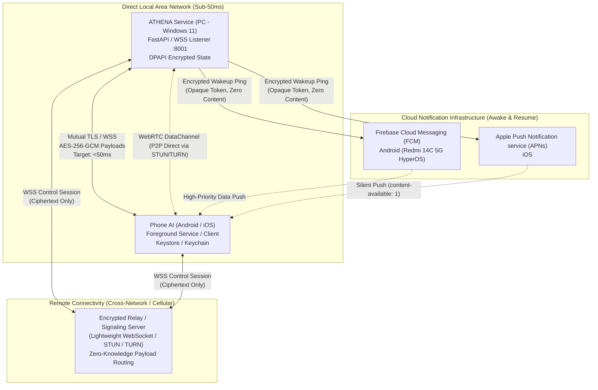
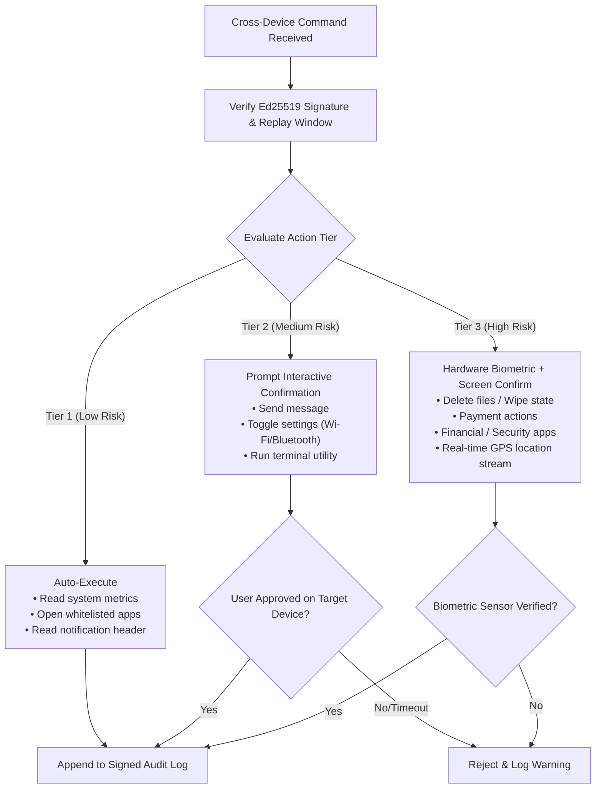
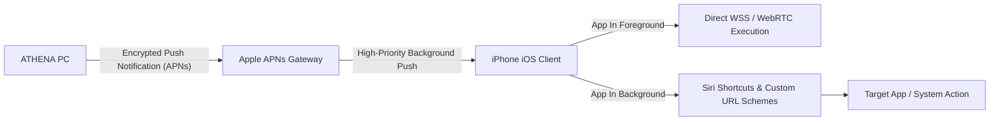
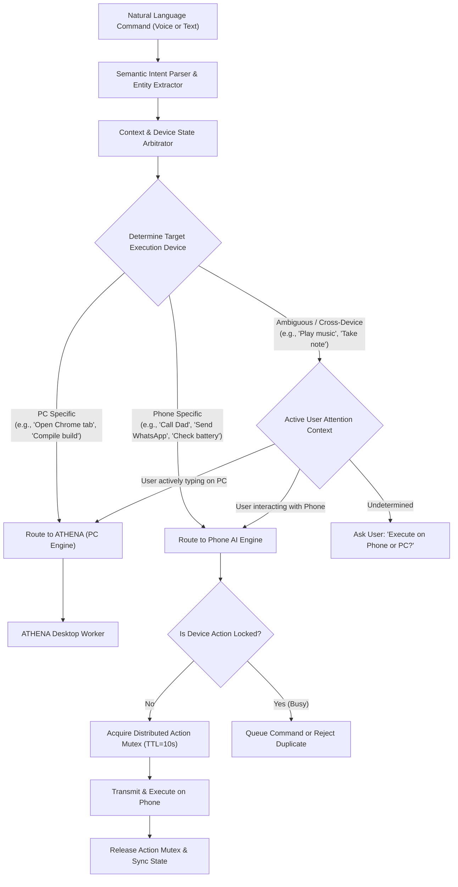

# HONESTIC OS: ATHENA (PC) + PHONE AI (Android / iOS)
## Master Architecture & Security Specification (Production Grade)

---

## 1. System Overview & Component Topography



### 1.1 Components Breakdown

1. **ATHENA Core & Companion Service (Windows 11)**:
   - **Role**: Primary coordinator, master system orchestrator, desktop controller.
   - **Networking**: WSS server on port `8001` (LAN) + outbound client to the Remote Relay (`relay.honestic.ai:443`).
   - **Storage & Security**: Windows DPAPI for persistent tokens, private keys (`X25519`, `Ed25519`), paired device registry, and audit trail.
   - **Capabilities**: Full access to Mark-LVI local OS automation (actions, apps, workspace, Gemini Live pipeline, computer controls).

2. **Phone AI Engine (Android Primary / iOS Secondary)**:
   - **Android Client (Redmi 14C 5G / Xiaomi HyperOS / Android 14+)**:
     - Kotlin / Coroutines / Jetpack Compose native application.
     - `AccessibilityService` for UI inspection and permitted app automation.
     - Custom Foreground Service (`AthenaPhoneService`) with `specialUse` / `connectedDevice` permissions for persistent LAN/relay sockets.
     - Hardware-backed Android Keystore (`KeyGenParameterSpec`) for hardware-level private key protection.
   - **iOS Client (iOS 17+)**:
     - Swift / SwiftUI client.
     - Sandboxed execution relying on Siri Shortcuts, Universal Links / URL Schemes, and APNs background execution.
     - Apple Keychain (`kSecAccessControlBiometryAny`) storage.

3. **Remote Signaling & Relay Server**:
   - Rust or Go-based high-concurrency, zero-knowledge multiplexer.
   - Routes encrypted frames between paired `device_id` endpoints.
   - Built-in STUN/TURN server (coturn compatible) for WebRTC DataChannel hole-punching.
   - **Zero-Knowledge Guarantee**: Relay parses outer framing (`recipient_device_id`, `iv`, `length`), but payload is an unreadable `AES-256-GCM` ciphertext keyed exclusively between the PC and Phone.

4. **Push Notification Gateway**:
   - Dispatches zero-payload notification pings via FCM HTTP v1 / APNs HTTP/2.
   - Payload contains only: `{ "type": "SYNC_PING", "session_hint": "<ephemeral_id>", "ts": 1729837200 }`.
   - The phone wakes up, opens a secure direct WSS session to ATHENA or the Relay, and fetches encrypted instructions end-to-end.

---

## 2. Security Threat Model & Defense-in-Depth

### 2.1 Threat Vectors & Mitigations

| Threat Vector | Severity | Attack Surface | Mitigation Strategy |
| :--- | :--- | :--- | :--- |
| **Relay Server Compromise** | Critical | Cloud Relay | **Zero-Knowledge Architecture**: All data payloads are encrypted via `AES-256-GCM` using keys derived via mutual X25519 ECDH. The relay holds zero key material and cannot decrypt or tamper with messages. |
| **Man-in-the-Middle (MITM)** | High | LAN / Wi-Fi / WAN | Mutual TLS (mTLS) with pinned Ed25519 public keys exchanged during out-of-band QR code pairing. Certificate authority compromise does not affect pinned key trust. |
| **Replay Attacks** | High | Network Capture | Monotonic sequence counters (`seq`), random 128-bit nonces (`jti`), and strict sliding timestamp windows ($\Delta t \le 30\text{ s}$) with replay cache. |
| **Stolen Phone / Physical Access** | High | Phone Device | Tiered authorization: Tier 3 commands require hardware-backed biometric authentication (Android BiometricPrompt / iOS FaceID/TouchID). |
| **Malicious Rogue Commands** | Critical | Cross-Device Execution | Command whitelist, explicit user consent screens, and continuous audit logging with digital signatures. |
| **Android Accessibility Abuse** | Critical | HyperOS / Android OS | Strict app-package whitelist; no full-screen overlays allowed; prominent runtime accessibility disclosure. |

---

## 3. Cryptographic Key Management & Pairing Flow

```mermaid
sequenceDiagram
    autonumber
    actor User
    participant PC as ATHENA (Windows 11)
    participant Display as PC Screen (QR Display)
    participant Phone as Phone AI (Redmi 14C 5G)
    participant Keystore as Hardware Keystore

    User->>PC: Clicks "Pair New Device"
    PC->>PC: Generate Ephemeral ECDH (X25519_PC_eph)
    PC->>PC: Generate 256-bit One-Time Secret (OTS)
    PC->>Display: Render QR Code: { lan_ip, port, pc_ed25519_pub, eph_pub, ots, expires_at }
    User->>Phone: Scans QR Code with Phone Camera
    Phone->>Keystore: Generate/Load Device Identity (Ed25519_Phone) & Ephemeral (X25519_Phone_eph)
    Phone->>Phone: Compute Shared Secret = ECDH(X25519_Phone_eph, X25519_PC_eph)
    Phone->>Phone: Derive PairingKey = HKDF-SHA256(Secret, salt=OTS, info="ATHENA-PAIR-v1")
    Phone->>PC: WSS Connect -> Send PAIR_REQUEST (Encrypted with PairingKey, signed by Ed25519_Phone)
    PC->>PC: Validate OTS & Expiry; Decrypt with PairingKey; Verify Signature
    PC->>User: Display Pairing Prompt: "Pair Redmi 14C 5G [Fingerprint: 3A:F8:...]? Allow?"
    User->>PC: Confirms on PC
    PC->>Phone: PAIR_CONFIRM { session_token, pc_identity_proof } (Encrypted)
    PC->>PC: Pin Ed25519_Phone_pub into DPAPI Registry
    Phone->>Phone: Pin Ed25519_PC_pub into Keystore
    Note over PC,Phone: Device Pinned & Authenticated. Future sessions use Mutual Authenticated Key Exchange.
```

### 3.1 Key Specifications
- **Identity Keys**: `Ed25519` (Curve25519 for Edwards-curve Digital Signature Algorithm). Pinned indefinitely until revoked.
- **Key Agreement (Session Exchange)**: `X25519` ECDH. A fresh ephemeral key pair is generated per session and renewed every 24 hours or after $10,000$ messages.
- **Symmetric Encryption**: `AES-256-GCM` with a 96-bit unique IV (counter-derived + random prefix) and 128-bit authentication tag.
- **Key Derivation Function (KDF)**: `HKDF-SHA256` (RFC 5869) utilizing session secrets, salts, and platform-specific info tags.
- **Secrets Storage**:
  - **Windows 11**: Windows Data Protection API (`CryptProtectData` / `DPAPI`) encrypting credentials bound to user profile.
  - **Android (Redmi 14C 5G)**: Android Keystore Provider with `KeyProperties.PURPOSE_ENCRYPT | KeyProperties.PURPOSE_SIGN` and `setUserAuthenticationRequired(false)` for background tokens, and a separate biometrically-gated key with `setUserAuthenticationRequired(true)` for Tier 3 actions.
  - **iOS**: Secure Enclave Keychain services (`kSecAttrAccessibleAfterFirstUnlockThisDeviceOnly`).

---

## 4. Command Authorization Tiers

Cross-device actions are strictly stratified to prevent unauthorized autonomous behavior:



### 4.1 Detailed Tier Specifications

| Tier | Classification | Permitted Scope | Authentication Requirement | Timeout |
| :--- | :--- | :--- | :--- | :--- |
| **Tier 1** | **Read / Informational / Whitelisted Launch** | • Query battery, CPU, RAM<br/>• Launch approved app (e.g. YouTube, Calculator)<br/>• Sync clipboard (text only)<br/>• Play audio / ping device | Signature verification only | Instant |
| **Tier 2** | **State Mutation / Outbound Communication** | • Draft/send text message<br/>• Mute/unmute microphone<br/>• Initiate file transfer ($< 50\text{ MB}$)<br/>• Toggle system settings | On-screen notification prompt: "Allow ATHENA to [Action]?" | 30 seconds |
| **Tier 3** | **Sensitive Data / Financial / System Critical** | • Delete local files or reset storage<br/>• Accessibility clicks inside banking/messaging apps<br/>• Share live coordinates<br/>• Execute shell scripts | System Biometric Prompt (Fingerprint / Face ID) + explicit double-confirmation | 15 seconds |

---

## 5. Android Implementation & Xiaomi HyperOS Optimization

### 5.1 Redmi 14C 5G (HyperOS / Android 14) Realities
Xiaomi HyperOS features aggressive background process management (MIUI Power Keeper / Battery Saver) which terminates background sockets unless properly configured.

1. **Foreground Service Lifecycle**:
   - `AthenaPhoneService` runs with `foregroundServiceType="connectedDevice|specialUse"`.
   - Explicit user guided battery exemption: Direct intent launch to `MIUI battery optimization` whitelist (`miui.intent.action.POWER_HIDE_MODE_APP_LIST`).
   - `BOOT_COMPLETED` receiver to auto-restore connectivity after device reboot.

2. **AccessibilityService Architecture (`AthenaAccessibilityService`)**:
   - **Target Scope**: UI Automation only on user-approved packages (`com.whatsapp`, `com.google.android.apps.messaging`, `com.google.android.youtube`, etc.).
   - **Package Filtering**: In `AccessibilityServiceInfo`, specify explicit `packageNames` array; avoid `flagDefault` / blanket event interception.
   - **Prominent Disclosure**: A full-screen dialog shown *before* redirecting to Android Accessibility Settings, explaining:
     > *"ATHENA requires Accessibility access solely to automate actions inside apps you explicitly approve in the Whitelist. ATHENA never logs keystrokes, reads passwords, or captures payment data."*
   - **HyperOS Restricted Settings Bypass**: On Android 13/14, sideloaded apps have Accessibility blocked by default ("Restricted setting"). The onboarding wizard guides the user: *App Info $\rightarrow$ Three Dots $\rightarrow$ Allow restricted settings*.

3. **Wake-Word & Local Voice Engine**:
   - Integrated lightweight `Vosk` / `OpenWakeWord` running on a high-priority background thread using Android AudioRecord ($16\text{ kHz}$ mono).
   - Multi-lingual model loading: English, Telugu, Hindi phoneme models.

---

## 6. iOS Integration & Architectural Boundaries

Due to Apple Sandbox constraints, iOS acts in an asymmetric model:



### 6.1 Capability Matrix (Android vs. iOS)

| Feature | Android (Redmi 14C 5G) | iOS (iPhone) |
| :--- | :--- | :--- |
| **UI Screen Inspection** | **Full** (Accessibility Node Hierarchy) | **None** (Sandboxed) |
| **Automated Clicks / Taps** | **Full** (`dispatchGesture` on whitelisted apps) | **None** |
| **App Launching** | **Direct Intent** (even from background) | **URL Schemes / Shortcuts** |
| **Background Connectivity** | **Persistent Foreground Service** | **Push-Triggered Background Tasks** ($30\text{s}$ limit) |
| **Biometric Authorization** | `BiometricPrompt` (Class 3 Biometrics) | `LocalAuthentication` (Face ID / Touch ID) |
| **Local Wake-Word** | Continuous mic stream in foreground service | Foreground app only / Siri Shortcut trigger |

---

## 7. Dual-AI Intent Router & Conflict Resolution



### 7.1 Distributed Locking & Idempotency
- **Distributed Mutex**: A lightweight cross-device token lock prevents both AIs from operating on the same target (e.g. playing audio or modifying a shared file) simultaneously.
- **Idempotency Key**: Every command is tagged with a UUID v4 `idempotency_key`. The receiver stores processed keys in an LRU cache ($1,000$ entries). Duplicate incoming keys within $5\text{ minutes}$ return the cached outcome without re-executing.

---

## 8. Network Engine & Real-Time Protocol

### 8.1 Wire Protocol Framing (Binary/JSON over WSS)

Every packet exchanged over WSS or WebRTC DataChannel conforms to the following strict framing:

```json
{
  "v": 1,
  "id": "f81d4fae-7dec-11d0-a765-00a0c91e6bf6",
  "seq": 1042,
  "ts": 1729837200542,
  "sender": "device_pc_ed25519_pub_prefix",
  "recipient": "device_phone_ed25519_pub_prefix",
  "nonce": "a1b2c3d4e5f6789012345678",
  "auth_tier": 2,
  "encrypted_payload": "Base64GCMCiphertextAndTag...",
  "sig": "Base64Ed25519SignatureOfHeaderAndCiphertext..."
}
```

### 8.2 Plaintext Payload (Inside `encrypted_payload`)
```json
{
  "action": "AUTOMATE_APP",
  "package": "com.whatsapp",
  "intent": "SEND_MESSAGE",
  "params": {
    "recipient": "+919876543210",
    "text": "Hello, reaching out via ATHENA."
  },
  "timeout_ms": 10000
}
```

### 8.3 Network Fallback Hierarchy & Recovery
1. **Direct LAN (Primary)**:
   - PC broadcasts mDNS service `_athena-remote._tcp.local.` on port `8001`.
   - Phone connects directly. Latency target: **$10\text{ ms} - 45\text{ ms}$**.
2. **WebRTC P2P DataChannel (Secondary)**:
   - If PC and phone are on different subnets / cellular, Relay provides SDP signaling.
   - STUN hole-punching attempts direct UDP connection. Latency target: **$35\text{ ms} - 90\text{ ms}$**.
3. **Turn Relay (Tertiary)**:
   - Symmetric NAT traversal fails $\rightarrow$ packets routed via Relay WebSocket. Latency target: **$80\text{ ms} - 160\text{ ms}$**.
4. **Offline Queue (Disconnected State)**:
   - Network drops $\rightarrow$ Outgoing commands stored in encrypted SQLite `pending_commands` table.
   - Exponential backoff retry ($1\text{s}, 2\text{s}, 4\text{s}, \dots, 30\text{s}$). Re-connection flushes and deduplicates.

---

## 9. Feature Evaluation & Top 3 MVP Selection

| Feature | Value | Complexity | Security Risk | Battery Impact | Verdict |
| :--- | :--- | :--- | :--- | :--- | :--- |
| **1. Clipboard Sync (Phone $\leftrightarrow$ PC)** | **High** | **Low** | **Medium** | **Very Low** | **SELECTED (TOP 1)** |
| **2. Emergency Kill Switch** | **Critical** | **Low** | **Low** | **Zero** | **SELECTED (TOP 2)** |
| **3. App Whitelist UI & Enforcement** | **Critical** | **Medium** | **High (Defensive)**| **Low** | **SELECTED (TOP 3)** |
| 4. Notification Mirroring | High | Medium | Medium | Medium | Phase 2 Backlog |
| 5. File Push (Phone $\leftrightarrow$ PC) | High | Medium | Medium | Medium | Phase 2 Backlog |
| 6. Shared Context Memory | High | High | Low | Low | Phase 2 Backlog |
| 7. Cross-Device Task Handoff | Medium | High | Low | Low | Phase 2 Backlog |
| 8. Battery / Data Usage Monitor | Medium | Low | Low | Low | Phase 2 Backlog |
| 9. WebRTC Screen Streaming | Medium | High | High | Very High | Phase 2 Backlog |
| 10. Multi-User / Guest Mode | Low | High | Medium | Low | Phase 2 Backlog |

### The Top 3 Selected Features:
1. **Bi-directional Clipboard Sync**: Instant cryptographic sync of text snippets with auto-clearing for password formats.
2. **Emergency Kill Switch**: One-click revocation in ATHENA UI and on the phone widget that terminates all active sockets, flushes session keys, and halts any running automation.
3. **App Whitelist UI & Enforcement**: Mandatory security gate on Android where only apps explicitly checked by the user can be manipulated by ATHENA.

---

## 10. Phased Implementation Roadmap

```mermaid
gantt
    title Dual-AI Production Implementation Phases
    dateFormat  YYYY-MM-DD
    section Architecture & Security
    Phase 1: Cryptographic Engine & QR Pairing        :active, p1, 2026-10-30, 2d
    section Core Connectivity
    Phase 2: LAN WSS Pipeline + Intent Router          :p2, after p1, 2d
    Phase 3: Push Notification Infrastructure (FCM)   :p3, after p2, 2d
    section Device Execution
    Phase 4: Android Accessibility (Redmi 14C 5G)      :p4, after p3, 3d
    Phase 5: Cloud Relay & WebRTC Remote Channel      :p5, after p4, 2d
    Phase 6: iOS Shortcuts & Sandboxed Client         :p6, after p5, 2d
    section Hardening & Features
    Phase 7: Security Audit, Revocation & Replay       :p7, after p6, 2d
    Phase 8: Top 3 Features (Clipboard, Kill, Whitelist):p8, after p7, 2d
    Phase 9: Real-Device Stress & Chaos Testing       :p9, after p8, 3d
```

---

## 11. MVP Scope Lock (First Deliverable)

The initial deployment will be strictly scoped to guarantee 100% operational reliability on the physical **Redmi 14C 5G**:
1. **Security**: X25519 + Ed25519 pairing via QR Code, AES-256-GCM encrypted framing, replay protection ($30\text{s}$ window), hardware Keystore/DPAPI storage.
2. **Connectivity**: Direct LAN WebSocket Secure (`WSS`) operating with $<50\text{ms}$ latency.
3. **Control**: Basic Android device control (Open whitelisted apps, read battery/system health, display notification).
4. **Safety**: On-screen action previews, App Whitelist UI, and One-Click Emergency Kill Switch.
5. **Observability**: Structured cross-device audit logging with timestamped proof.
