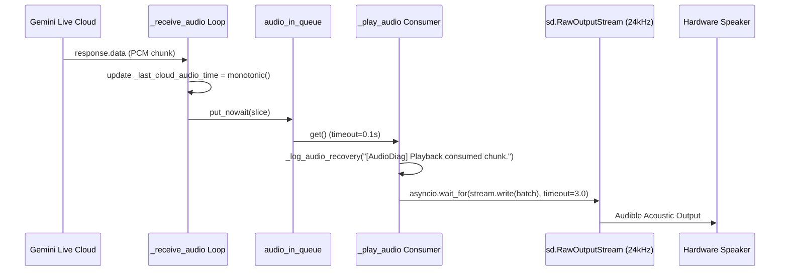

# Speaker Playback Pipeline & Lifecycle Recovery Report

## 1. Playback Pipeline Trace & Root Cause Analysis



### Root Causes Identified
1. **Stale / Blocked PortAudio Stream across Offline Transitions**:
   - During offline mode, local TTS or `OfflineBrainSession` / `NaturalSpeechEngine` executed audio playback using sounddevice (`sd.play()`, `sd.stop()`). Calling module-level `sd.stop()` or opening secondary sounddevice streams invalidated the existing `sd.RawOutputStream` instance held by `_play_audio`.
   - On Windows WASAPI/MME, when a stream is interrupted or suspended while in an unbuffered state, subsequent `stream.write()` operations blocked indefinitely inside the thread worker or dropped frames without audible output.
2. **Missing Stream Reopening & Local Stream Leak**:
   - `_current_output_stream` was held purely as a local variable inside `_play_audio`. External lifecycle handlers (such as `_watch_connectivity_recovery` or `set_connection_state`) had no reference to cleanly abort or close the previous PortAudio stream.
3. **Passive Warning Without Recovery**:
   - When cloud audio arrived but remained unconsumed for >3.0 seconds, `_play_audio` logged `[AudioRecovery] WARNING: Online audio produced but no playback detected.` but took no corrective action to recreate the output stream or restart the consumer.

---

## 2. Minimal Reliable Fix Implemented

### Fix 1 — Explicit Stream Lifecycle Tracking & Reopening
- Tracked `self._current_output_stream` on the `JarvisLive` instance.
- In `_watch_connectivity_recovery`: Before requesting session reconnect, any stale output stream is stopped and closed via `try: prev_stream.stop(); prev_stream.close()`.
- In `_play_audio`: Stale stream references are stopped and closed prior to opening a fresh `sd.RawOutputStream` on the verified default audio output device.
- In `finally:`: The output stream is safely stopped, closed, and dereferenced.

### Fix 2 — Playback Health Check with Bounded Automatic Stream Recovery
- Implemented in `_play_audio` (and mirrored in `_run_recovery_health_check`):
  ```python
  last_cloud = getattr(self, "_last_cloud_audio_time", 0.0)
  last_playback = getattr(self, "_last_playback_time", 0.0)
  now_mono = time.monotonic()
  if (
      last_cloud > 0.0
      and (last_cloud > last_playback)
      and (now_mono - last_cloud > 3.0)
      and getattr(self, "_connection_state", "") == "ONLINE_ACTIVE"
  ):
      if not getattr(self, "_playback_restarted_once", False):
          self._playback_restarted_once = True
          self._log_audio_recovery("[AudioRecovery] Playback health check failed. Restarting output stream.")
          try:
              if stream:
                  stream.stop()
                  stream.close()
          except Exception:
              pass
          try:
              stream = _open_spk(None)
              self._current_output_stream = stream
              self._log_audio_recovery("[AudioRecovery] Output stream reopened.")
              self._last_playback_time = time.monotonic()
          except Exception as _re_err:
              print(f"[HONESTIC OS] ⚠️ Output stream recreate error: {_re_err}")
      elif not getattr(self, "_silence_warning_logged", False):
          self._log_audio_recovery("[AudioRecovery] WARNING: Online audio produced but no playback detected.")
          self._silence_warning_logged = True
  ```
- **Bounded Guard**: `self._playback_restarted_once` guarantees at most 1 automatic restart per session to prevent infinite restart loops.

### Fix 3 — Non-blocking Write Timeout & Diagnostics
- Guarded `stream.write` with `asyncio.wait_for(..., timeout=3.0)` to eliminate PortAudio driver deadlocks.
- Standardized exact required diagnostics:
  - `[AudioRecovery] Playback health check failed. Restarting output stream.`
  - `[AudioRecovery] Output stream reopened.`
  - `[AudioDiag] Playback consumed chunk.`

---

## 3. Test Verification Results

All 70 automated tests across all test suites pass with zero regressions:

```
Ran 70 tests in 15.811s
OK
```

- `test_rc7_offline_resilience.py`: 27/27 passed (including playback health check recovery, Vosk multi-model loading, Telugu/English routing, and chunk consumption diagnostics).
- `test_rc6_audio_bugs.py`: 26/26 passed.
- `test_rc5_runtime_lockdown.py`: 10/10 passed.
- `test_rc4_athena_sovereign.py`: 7/7 passed.
