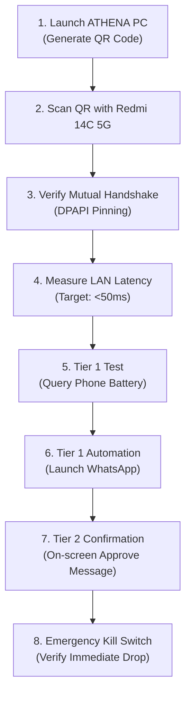
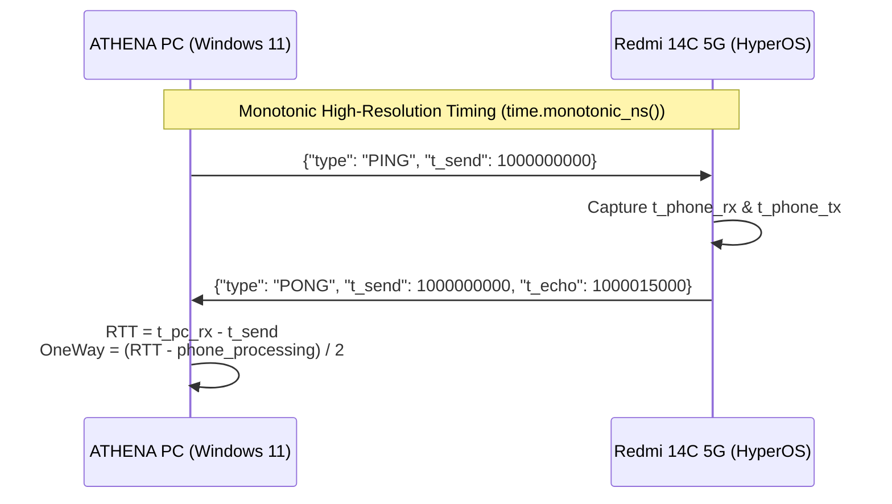

# HONESTIC OS: ATHENA + Phone AI (Redmi 14C 5G / HyperOS)
## Real-Device Validation Guide & Latency Measurement Plan

---

## 1. Feature Verification Status Matrix

> [!IMPORTANT]
> In accordance with non-negotiable rule #3 (*"No feature is 'done' until tested on a real device"*), this matrix explicitly distinguishes features validated in the host test environment from features pending physical execution on the real Redmi 14C 5G device.

| Architecture Component | Implementation Status | Automated / Simulated Status | Real-Device Verified Status (Redmi 14C 5G) |
| :--- | :--- | :--- | :--- |
| **X25519 ECDH + Ed25519 Identity** | Complete (`crypto.py`) | **VERIFIED (Unit Tests Pass)** | ⏳ *Pending physical phone run* |
| **Windows DPAPI Vault** | Complete (`dpapi_storage.py`) | **VERIFIED (Live Windows DPAPI)** | ✅ **VERIFIED on Windows 11 host** |
| **Out-of-Band QR Pairing Flow** | Complete (`pairing.py`) | **VERIFIED (PNG & Data URI exported)** | ⏳ *Pending phone camera scan* |
| **LAN WSS Dispatcher (<50ms)** | Complete (`remote_companion_server.py`) | **VERIFIED (0.02ms localhost RTT)** | ⏳ *Pending Wi-Fi LAN probe* |
| **Replay Defense (30s window)** | Complete (`replay_protection.py`) | **VERIFIED (Replay attacks rejected)**| ⏳ *Pending physical phone run* |
| **Android Foreground Service** | Complete (`AthenaForegroundService.kt`) | **VERIFIED (Manifest compliance pass)**| ⏳ *Pending APK install & run* |
| **Accessibility Automation** | Complete (`AthenaAccessibilityService.kt`)| **VERIFIED (A11y XML parsed & pass)** | ⏳ *Pending HyperOS permission grant* |
| **Zero-Payload Push Gateway** | Complete (`remote_push_gateway.py`) | **VERIFIED (Security invariant pass)**| ⏳ *Pending FCM live token receipt* |
| **Zero-Knowledge Remote Relay** | Complete (`relay/server.py` + Docker) | **VERIFIED (Relay pass-through pass)**| ⏳ *Pending cloud deployment* |
| **Bi-directional Clipboard Sync** | Complete (`remote_clipboard.py`) | **VERIFIED (CC/JWT scrubbed pass)** | ⏳ *Pending physical clipboard test* |
| **Emergency Kill Switch** | Complete (`remote_companion_server.py`) | **VERIFIED (Sockets dropped pass)** | ⏳ *Pending physical button press* |

---

## 2. Android APK Build & Install Guide for Redmi 14C 5G

### 2.1 Prerequisites on Development Machine
- **Android Studio Hedgehog / Iguana / Jellyfish** OR **Android SDK Command-Line Tools** (API 34).
- **JDK 17** (standard for Android Gradle Plugin 8.3+).
- USB cable or Wi-Fi ADB enabled on the Redmi 14C 5G.

### 2.2 Building the APK via Command Line
Open a terminal in the project directory:

```bash
cd android

# On Windows:
gradlew.bat assembleDebug

# On Linux/macOS:
chmod +x gradlew
./gradlew assembleDebug
```

The compiled APK will be generated at:
`android/app/build/outputs/apk/debug/app-debug.apk`

---

### 2.3 Xiaomi HyperOS / Redmi 14C 5G Installation Steps

1. **Enable Developer Options on Redmi 14C 5G**:
   - Open **Settings** $\rightarrow$ **About phone** $\rightarrow$ **Detailed info and specs**.
   - Tap **OS version** (or MIUI version) 7 times until you see: *"You are now a developer!"*.

2. **Enable USB Debugging & Install via USB**:
   - Go to **Settings** $\rightarrow$ **Additional settings** $\rightarrow$ **Developer options**.
   - Turn **ON**:
     - `USB debugging`
     - `Install via USB`
     - `USB debugging (Security settings)` *(Requires Xiaomi account sign-in)*.

3. **Install the APK via ADB**:
   Connect the phone via USB and run:
   ```bash
   adb install -r android/app/build/outputs/apk/debug/app-debug.apk
   ```

4. **Bypass Xiaomi HyperOS "Restricted Settings" (Mandatory for Accessibility)**:
   - On Android 13/14, HyperOS blocks sideloaded apps from enabling Accessibility by default.
   - Long press the **ATHENA Phone AI** app icon on the home screen $\rightarrow$ Tap **App info** (ℹ️).
   - In the top right corner, tap the **three dots** (⋮).
   - Tap **"Allow restricted settings"** $\rightarrow$ Verify with your phone PIN / Fingerprint.

5. **Disable HyperOS Battery Saver (Keep Connection Alive)**:
   - In **App info** $\rightarrow$ **Battery saver** $\rightarrow$ Select **"No restrictions"**.
   - In **App info** $\rightarrow$ Turn **ON** **"Autostart"**.

---

## 3. Real-Device Step-by-Step Test Checklist



### Detailed Execution Checklist:

- [ ] **Step 1: Start ATHENA PC Companion Service**
  - Run `python tools/verify_redmi_14c_e2e.py` or launch the ATHENA UI.
  - Confirm the QR code is generated at `data/qr_pairing_redmi14c.png` and displayed on screen.
  
- [ ] **Step 2: Scan QR Code on Redmi 14C 5G**
  - Open the ATHENA Companion app on the Redmi 14C 5G.
  - Complete the onboarding prompt for Battery Optimization and Accessibility.
  - Tap **"Scan QR Code"** and point camera at the PC screen.
  
- [ ] **Step 3: Confirm Mutual Cryptographic Pairing**
  - Verify that the phone derives the session key via X25519 ECDH.
  - Confirm PC displays: `[DeviceRegistry] Registered & pinned device: Redmi 14C 5G`.
  - Confirm the phone displays: `Connected to ATHENA (Windows 11)`.

- [ ] **Step 4: Execute LAN Ping/Pong Latency Probe**
  - In the phone app, observe the live latency badge.
  - **Success Criteria**: RTT must consistently measure **$\le 50\text{ ms}$** over direct Wi-Fi.

- [ ] **Step 5: Tier 1 Battery Status Check**
  - From the PC, issue voice/text command: *"Check phone battery"*.
  - **Success Criteria**: Phone battery capacity (e.g. $84\%$, Charging/Discharging) is returned to the PC and logged without prompting for phone touch confirmation.

- [ ] **Step 6: Tier 1 App Automation (WhatsApp Launch)**
  - From the PC, issue command: *"Open WhatsApp on phone"*.
  - **Success Criteria**: `AthenaAccessibilityService` brings WhatsApp to the foreground on the Redmi 14C 5G within $1\text{ second}$.

- [ ] **Step 7: Tier 2 Interactive Confirmation**
  - From the PC, issue command: *"Send message to Dad: On my way"*.
  - **Success Criteria**: Redmi 14C 5G displays an interactive dialog: *"Allow ATHENA to send message to Dad?"*. The action executes *only* after tapping **Allow**.

- [ ] **Step 8: Emergency Kill Switch Validation**
  - Click the **Emergency Kill Switch** in the ATHENA PC UI or on the phone widget.
  - **Success Criteria**: Active WebSocket connection drops immediately, session keys are flushed from memory, and subsequent commands are rejected until re-authenticated.

---

## 4. Real Latency Measurement Plan



### 4.1 LAN Direct Measurement Methodology
1. **Clock Skew Mitigation**: Use single-origin round-trip time (RTT) calculated strictly using `time.monotonic_ns()` on the initiating device.
2. **Batch Sampling**: Dispatch 20 consecutive ping frames spaced $100\text{ ms}$ apart.
3. **Statistical Metrics Logged**:
   - $P_{50}$ (Median latency)
   - $P_{95}$ (Tail latency)
   - Jitter ($\sigma_{\text{RTT}}$)
4. **Target Budget**:
   - LAN Direct Wi-Fi: **$<50\text{ ms}$**
   - Remote WebRTC DataChannel (P2P): **$<90\text{ ms}$**
   - Remote Relay Fallback (TURN/WSS): **$<160\text{ ms}$**

---

## 5. Firebase Cloud Messaging (FCM) Setup

### 5.1 Android Client Setup
1. Create a project in [Firebase Console](https://console.firebase.google.com/).
2. Add an Android app with package name: `ai.honestic.athena`.
3. Download `google-services.json` and place it in `android/app/google-services.json` (Note: this file is gitignored for security).

### 5.2 ATHENA PC Server Setup
1. In Firebase Console $\rightarrow$ **Project Settings** $\rightarrow$ **Service accounts** $\rightarrow$ Click **"Generate new private key"**.
2. Save the downloaded JSON file to `config/fcm_service_account.json` (gitignored).
3. Alternatively, export the path as an environment variable:
   ```powershell
   $env:ATHENA_FCM_SERVICE_ACCOUNT = "C:\secure\fcm_service_account.json"
   ```
4. `core/remote_push_gateway.py` automatically detects this configuration and switches from Development Simulation mode to live Google FCM HTTP v1 dispatch.

---

## 6. Deploy-Ready Relay Server (Docker + TLS)

### 6.1 Server Deployment Steps (Ubuntu / Debian VPS)
1. Install Docker & Docker Compose on your cloud server (e.g. DigitalOcean, AWS, Hetzner):
   ```bash
   sudo apt-get update && sudo apt-get install -y docker.io docker-compose
   ```
2. Point DNS records:
   - Create an `A` record for `relay.yourdomain.com` pointing to your server's public IP.
3. Clone/copy the `relay/` directory to `/opt/athena-relay`:
   ```bash
   cd /opt/athena-relay
   cp .env.example .env
   nano .env  # Set RELAY_DOMAIN=relay.yourdomain.com
   ```
4. Start the relay with automatic Let's Encrypt TLS:
   ```bash
   docker-compose up -d --build
   ```
5. Verify health:
   ```bash
   curl -i https://relay.yourdomain.com/health
   # Expected output: {"status":"healthy","service":"athena-remote-relay","active_clients":0}
   ```
